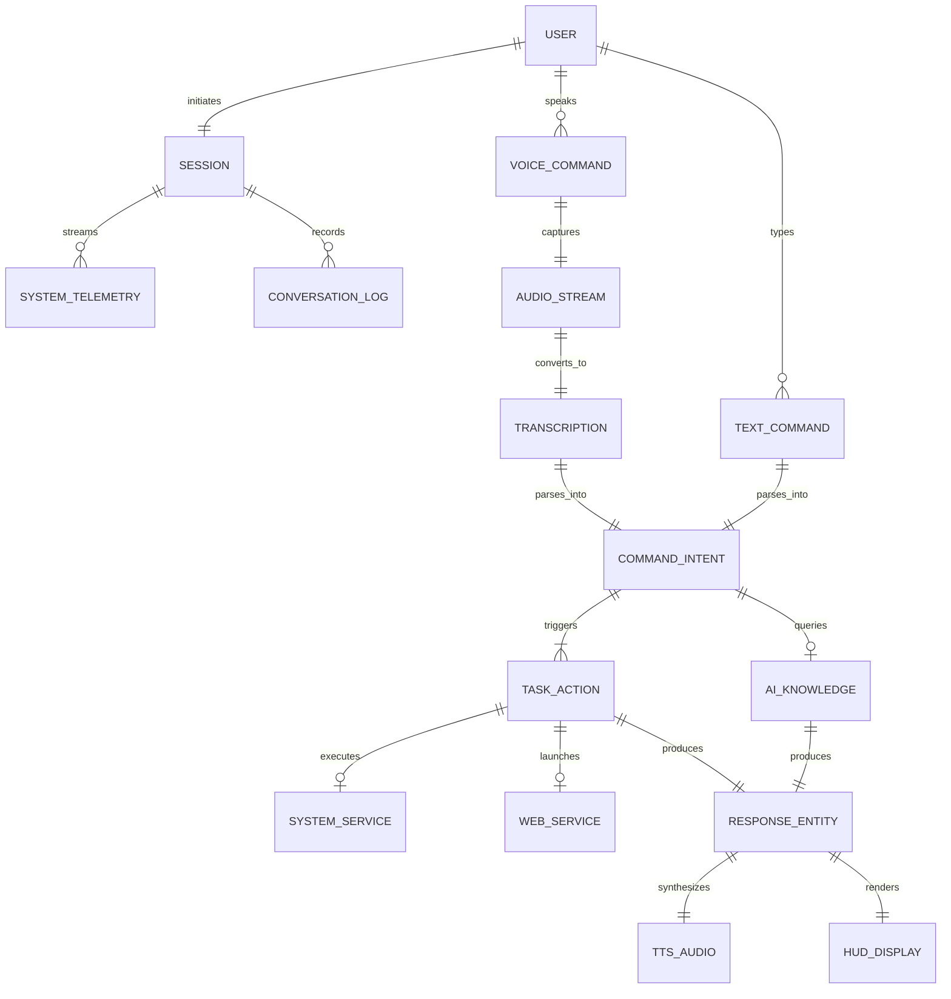

# 📊 JARVIS 2.0 ULTRA — System Architecture & Entity Relationship Documentation (ERD)

**Project Title:** AI-Based Neural Voice Assistant (JARVIS 2.0 Ultra)  
**Type:** College Mini Project / Advanced Python Automation System  
**Repository:** [collage-mini-project](https://github.com/mishraprem14-debug/collage-mini-project.git)  

---

## 1. Project Overview & Scope

**JARVIS 2.0 Ultra** is an intelligent, voice-operated cybernetic desktop assistant engineered with Python, FastAPI, and modern web technologies. It provides end-to-end hands-free desktop control, real-time system monitoring, natural language command parsing, voice synthesis, and a futuristic Iron Man-inspired Holographic Cybernetic HUD.

This document details the **Entity-Relationship Model (ERD)**, **data schemas**, **component pipelines**, and **architectural relationships** governing the system.

---

## 2. Entity Relationship Diagram (ERD)



---

## 3. Entity Dictionary & Schemas

### 3.1. `User` & `Session`
- **`SessionID`** *(UUID)*: Unique session identifier generated on server launch.
- **`StartTime`** *(Timestamp)*: Time the assistant system initialized.
- **`InputMode`** *(Enum)*: `VOICE_MIC`, `BROWSER_SPEECH_API`, or `TEXT_CLI`.
- **`ActiveTheme`** *(String)*: Current HUD theme (`arc-cyan`, `mark-85`, `matrix`, `cyberpunk`, `solar`).

### 3.2. `AudioStream` & `Transcription`
- **`AudioBuffer`** *(Raw PCM/WAV)*: Audio data recorded from microphone input.
- **`SampleRate`** *(Integer)*: 16,000 Hz standard capture rate.
- **`EnergyThreshold`** *(Float)*: Dynamic ambient noise sensitivity threshold.
- **`TranscribedText`** *(String)*: Textual transcription produced by Google Speech Recognition / PocketSphinx.
- **`ConfidenceScore`** *(Float)*: Confidence estimate for speech transcription.

### 3.3. `CommandIntent`
- **`RawText`** *(String)*: Original input phrase (e.g., *"Jarvis open YouTube and search quantum computing"*).
- **`IntentCategory`** *(Enum)*:
  - `APPLICATION_LAUNCH` (Notepad, Calculator, VS Code, Chrome, etc.)
  - `SYSTEM_CONTROL` (Screenshot, Volume, Minimize, Lock)
  - `MEDIA_PLAYBACK` (YouTube play, Spotify search)
  - `WEB_SEARCH` (Google, Wikipedia, Maps)
  - `AI_KNOWLEDGE` (General QA, Weather, Math, Quotes, Jokes)
  - `CONVERSATIONAL` (Greetings, identity, status check)
- **`ExtractedQuery`** *(String)*: Target query, application name, or URL.
- **`Timestamp`** *(ISO8601)*: Exact time command was processed.

### 3.4. `TaskAction` & `ResponseEntity`
- **`ActionType`** *(String)*: Identifier of executed function (e.g., `open_app`, `capture_screenshot`, `set_volume`).
- **`ExecutionStatus`** *(Enum)*: `SUCCESS`, `PENDING`, `FAILED`.
- **`SpeechResponse`** *(String)*: Text delivered to Text-To-Speech (TTS) engine.
- **`DisplayData`** *(JSON Object)*: Payload delivered to HUD frontend for UI status cards.

### 3.5. `SystemTelemetry`
- **`CPUPercent`** *(Float)*: Real-time CPU utilization percentage.
- **`RAMUsedGB`** / **`RAMTotalGB`** *(Float)*: Memory metrics in Gigabytes.
- **`DiskFreeGB`** *(Float)*: Remaining secondary storage space.
- **`BatteryPercent`** *(Integer)*: Battery charge status and AC plugging state.
- **`MasterVolume`** *(Integer)*: Windows core audio volume (0–100%).
- **`SystemUptime`** *(String)*: Formatted system uptime.

---

## 4. System Architecture & Processing Pipeline

```
+-------------------------------------------------------------------+
|                        1. INPUT SUBSYSTEM                         |
|   Web Speech API (Browser)  OR  Microphone (SpeechRecognition)   |
+---------------------------------+---------------------------------+
                                  |
                                  v
+-------------------------------------------------------------------+
|               2. SPEECH-TO-TEXT CONVERSION (STT)                  |
|          Google Speech Recognition API / Offline Sphinx           |
+---------------------------------+---------------------------------+
                                  |
                                  v
+-------------------------------------------------------------------+
|               3. NATURAL LANGUAGE COMMAND PROCESSOR               |
|      Wake-word filtering | Intent classification | Query extract   |
+-----------------+-------------------------------+-----------------+
                  |                               |
                  v                               v
+---------------------------------+   +-----------------------------+
|    4A. SYSTEM TASK EXECUTOR     |   |      4B. AI BRAIN & QA      |
| App launcher | OS volume control|   | Wikipedia API | PyJokes     |
| Screen capture | Browser search |   | Weather API | Math solver   |
+-----------------+---------------+   +---------------+-------------+
                  |                                   |
                  +---------------+-------------------+
                                  |
                                  v
+-------------------------------------------------------------------+
|                    5. OUTPUT & FEEDBACK PIPELINE                  |
|    Text-to-Speech Engine (pyttsx3)  +  Web HUD Visualizer / Audio |
+-------------------------------------------------------------------+
```

---

## 5. REST & WebSocket API Specification

| Endpoint | Method | Protocol | Description |
| :--- | :--- | :--- | :--- |
| `/` | `GET` | HTTP | Serves the Holographic HUD frontend interface (`index.html`). |
| `/api/command` | `POST` | HTTP | Accepts JSON command payload `{"text": "...", "speak_response": true}`. |
| `/api/listen` | `POST` | HTTP | Activates desktop microphone, captures audio, transcribes, and executes. |
| `/api/system-stats` | `GET` | HTTP | Returns instantaneous snapshot of hardware telemetry. |
| `/api/screenshot` | `POST` | HTTP | Captures screen, saves image, returns relative image URL. |
| `/api/volume` | `POST` | HTTP | Sets Windows audio level `{"level": 75}`. |
| `/api/speak` | `POST` | HTTP | Speaks custom text via pyttsx3 speech synthesizer. |
| `/ws` | `GET` | WebSocket | High-frequency telemetry stream push every 1.5 seconds. |

---

## 6. Technology Stack

- **Backend Runtime:** Python 3.10+
- **API Framework:** FastAPI & Uvicorn (ASGI)
- **Real-Time Layer:** WebSockets (asyncio)
- **Speech Recognition:** `SpeechRecognition` library with Google Speech API
- **Speech Synthesis:** `pyttsx3` with Windows SAPI5 audio driver
- **Desktop Automation:** `pyautogui`, `psutil`, `pycaw`, `screen-brightness-control`
- **Media & Knowledge:** `pywhatkit`, `wikipedia`, `pyjokes`
- **Frontend HUD:** HTML5, Modern Vanilla CSS, Procedural Canvas 2D (Arc Reactor), Web Audio API

---

## 7. How to Run

1. **Clone the repository:**
   ```bash
   git clone https://github.com/mishraprem14-debug/collage-mini-project.git
   cd collage-mini-project
   ```

2. **Install dependencies:**
   ```bash
   pip install -r requirements.txt
   ```

3. **Launch the system:**
   - Double-click `launch.bat`, or
   - Run in terminal:
     ```bash
     python main.py
     ```

4. **Access the HUD:**  
   Open your browser at `http://127.0.0.1:8000`.
